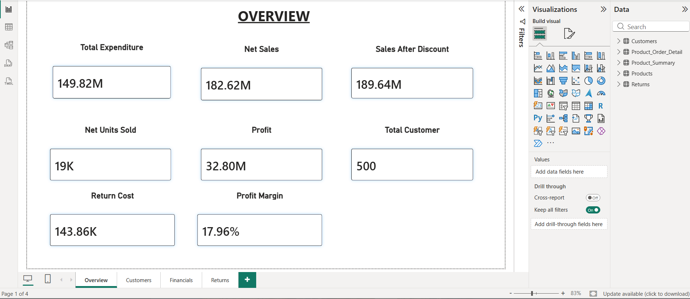
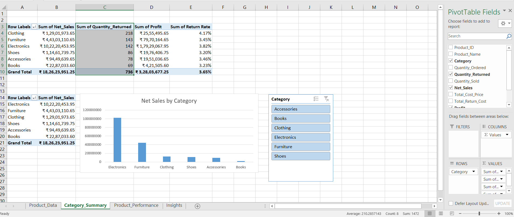

# ShopSphere E-commerce Analytics 

Its an end-to-end portfolio project using Python, SQL Server,
Power BI and Excel to analyse sales, profitability,
customer segments and product returns.

## Business Questions

- Which categories and products generate the most sales and profit?
- How does sales performance change over time?
- Which categories have the highest unit return rates?
- What reasons and product conditions are associated with returns?
- How much does the company spend on returns?

## Dataset

The project uses a synthetic e-commerce dataset for practice.

The analysed dataset contains:
- 500 customers
- 100 products across 6 categories
- 9,999 orders
- 500 return records, which covers 736 returned units

Main tables: Customers, Products, Orders and Returns.

## Workflow

### Python
Inspecting and cleaning data using pandas, which including duplicates,
missing values, text formatting cross-table validation among others.

### SQL Server
Joined related tables and creating product summaries and
order-level financial data for reporting.

### Power BI
Has four report pages:
- Overview
- Customers
- Financials
- Returns

DAX measures were used for calculating expenditure, profit, profit margin
and unit return rate, with relationships and visual interactions.

### Excel
Used for Creating:
- A category-summary PivotTable
- A sales PivotChart with a connected category slicer
- A Top 10 products-by-profit PivotTable
- Conditional-formatting data bars
- A calculated category return rate
- An insights and recommendations worksheet

## Key Results

| Metric | Value |
|---|---:|
| Net sales after returns | ₹18,26,23,951.25 |
| Profit under the project's costing assumptions | ₹3,28,03,677.25 |
| Profit margin | 17.96% |
| Units ordered | 20,175 |
| Units returned | 736 |
| Unit return rate | 3.65% |
| Return costs borne by the company | ₹1,43,859 |

## Key Findings

- Electronics generated the highest sales and total profit.
- Clothing has the highest category unit return rate at 4.17%,
  compared with 3.65% overall.
- Smartphone 034 generates the highest product profit:
  ₹19,28,512.70.

## Recommendations

- Review stock availability for high-performing products.
- Look into Clothing's return reasons and product conditions
  before recommending any corrective action.
- Identify which products and what return reasons are contributing most
  to return costs.

## Definitions

- Net units sold = Ordered units − Returned units
- Net sales = Sum of discounted unit price × net units sold
- Product cost = Sum of product cost price × net units sold
- Profit = Net sales − Product cost − Return costs
- Profit margin = Profit ÷ Net sales
- Unit return rate = Returned units ÷ Ordered units

Category return rates use aggregated quantities,
rather than adding individual product percentages.

## Limitations

- 2,650 orders precede recorded product launch dates.
- 3,226 orders precede recorded customer join dates.
  These groups may overlap.
- These date inconsistencies remained unresolved and limit
  date-based conclusions.
- Product costs use the available product cost price,
  without historical cost changes.
- Profit excludes expenses not represented in the dataset.
  Losses on unrecoverable returned goods are not separately
  modelled unless included in Return_Cost.
- Order-period return rates include recorded returns associated
  with those orders. They differ from returns received during
  a selected return month.

## Project Files

The project deliverables include Python cleaning code,
SQL scripts, a Power BI report and an Excel analysis workbook.

## Report Previews

### Power BI Overview

### Excel Category Summary

